# Lead Panther CRM

> **Multi-Tenant Real Estate Lead Management, Automated Distribution & Quality Assurance Platform**

Lead Panther CRM is an enterprise-grade Lead Management System (LMS) purpose-built for real estate developers, agencies, and channel partners. It automates the entire journey from multi-channel digital ingestion to automated deduplication, real-time credit deduction, intelligent sales routing, strict SLA tracking, and replacement guarantees.

---

## 🏗️ End-to-End System Workflow Architecture

### 1. High-Level Architecture Diagram (ASCII)

```text
                         ┌──────────────────────────────┐
                         │        LEAD SOURCES          │
                         └──────────────┬───────────────┘
                                        │
          ┌─────────────┬───────────────┼───────────────┬──────────────┐
          ↓             ↓               ↓               ↓              ↓
       META          GOOGLE       PROPERTY PORTALS   OWNED PORTALS   MANUAL/API
   FB / Instagram   Ads/Forms      99acres etc.      Dholera/Dubai    CSV/API
          │             │               │               │              │
          └─────────────┴───────────────┴───────────────┴──────────────┘
                                        ↓
                         ┌──────────────────────────────┐
                         │       API / WEBHOOK LAYER    │
                         │ Authentication + Validation  │
                         └──────────────┬───────────────┘
                                        ↓
                         ┌──────────────────────────────┐
                         │       LEAD INGESTION ENGINE   │
                         └──────────────┬───────────────┘
                                        ↓
                         ┌──────────────────────────────┐
                         │   NORMALIZATION & VALIDATION  │
                         │ Name / Phone / Email / Source │
                         │ Project / Campaign / City     │
                         └──────────────┬───────────────┘
                                        ↓
                         ┌──────────────────────────────┐
                         │      DUPLICATE ENGINE         │
                         │ Phone / Email / Source Rules  │
                         └──────────────┬───────────────┘
                                  ┌─────┴─────┐
                                  ↓           ↓
                              Duplicate     New Lead
                                  │           │
                                  ↓           ↓
                             Lead History   Lead Created
                                              │
                                              ↓
                              ┌─────────────────────────┐
                              │       LEAD DATABASE      │
                              │ Permanent Lead ID        │
                              │ Source + Campaign       │
                              │ Client + Project        │
                              │ Timestamp + Metadata    │
                              └────────────┬────────────┘
                                           ↓
                              ┌─────────────────────────┐
                              │ PROJECT / CLIENT MAPPING │
                              └────────────┬────────────┘
                                           ↓
                              ┌─────────────────────────┐
                              │     CREDIT CHECK         │
                              └────────────┬────────────┘
                                  ┌────────┴────────┐
                                  ↓                 ↓
                             Credits Available   No Credits
                                  │                 │
                                  ↓                 ↓
                              DISTRIBUTE        PAUSE CAMPAIGN
                                  │                 │
                                  ↓                 ↓
                           Sales Assignment     Notify Client
                                  │
                    ┌─────────────┼──────────────┐
                    ↓             ↓              ↓
                  CRM          WhatsApp         SMS
                    ↓             ↓              ↓
                  Email      Push Notification   │
                    └─────────────┼──────────────┘
                                  ↓
                           SALES EXECUTIVE
                                  ↓
                         15 / 30 MINUTE SLA
                                  ↓
                       FIRST STATUS UPDATE
                                  ↓
                  ┌───────────────┴──────────────┐
                  ↓                              ↓
             Updated on time                 Late / No update
                  │                              │
                  ↓                              ↓
        Replacement Eligibility             No Replacement
                  │
                  ↓
             LEAD JOURNEY
                  │
        ┌─────────┼──────────┬───────────┐
        ↓         ↓          ↓           ↓
     Contact   Interested  Follow-up   Not Interested
        ↓         ↓          ↓           ↓
     Meeting   Negotiation  Reminder   Replacement
        ↓         ↓
    Site Visit  Proposal
        ↓         ↓
      Booking ───┘
        ↓
     Payment
        ↓
   CLOSED WON
```

---

### 2. Interactive Flowchart (Mermaid)

```mermaid
flowchart TD
    subgraph Sources["1. LEAD SOURCES"]
        S_META["Meta Ads<br/>(FB & Instagram)"]
        S_GOOGLE["Google Ads<br/>(Search & Forms)"]
        S_PORTAL["Property Portals<br/>(99acres, MagicBricks)"]
        S_OWNED["Owned Portals<br/>(Dholera, Dubai sites)"]
        S_MANUAL["Manual / CSV / API<br/>(Bulk Upload, Direct API)"]
    end

    subgraph Ingestion["2. INGESTION & DEDUPLICATION"]
        GATEWAY["API & Webhook Layer<br/>(Signature Verification & Auth)"]
        ENGINE["Lead Ingestion Engine<br/>(ProcessInboundLeadJob)"]
        NORM["Normalization & Validation<br/>(Name, Mobile, Email, Project, City, UTM)"]
        DUP{"Duplicate Engine<br/>(90-Day Mobile / Email Check)"}
        DUP_LOG[("Duplicate History Logged<br/>(Appends LeadMetadata; zero credits deducted)")]
    end

    subgraph Storage["3. LEAD MASTER PERSISTENCE"]
        DB[("Lead Master Database<br/>(Permanent Code: LP-YYYY-XXXXXXXX)")]
        MAP["Project & Client Mapping<br/>(LeadFormMapping, Campaign Rules)"]
    end

    subgraph Credits["4. CREDIT PROTECTION ENGINE"]
        WALLET{"Credit Wallet Check<br/>(Pessimistic DB Row Lock)"}
        PAUSE["Pause Campaign<br/>(Status: pending_credit<br/>Notify Client to Recharge)"]
        RESERVE["Reserve 10 Credits<br/>(Status: assigned<br/>Proceed to Distribution)"]
    end

    subgraph Distribution["5. SALES ROUTING & MULTI-CHANNEL ALERTS"]
        ROUTING["Distribution Engine<br/>(Round Robin, Capacity Limits, Team Rules)"]
        ASSIGN["Sales Executive Assignment"]
        ALERTS["Multi-Channel Broadcast<br/>(CRM Notification, WhatsApp, SMS, Email, Push)"]
    end

    subgraph SLA["6. SLA FIRST-RESPONSE TRACKER"]
        CLOCK["15 / 30 Minute SLA Clock"]
        STATUS_CHECK{"First Status Update Recorded?"}
        SLA_MET["SLA Met<br/>(Eligible for Replacement Guarantee)"]
        SLA_LATE["SLA Breached<br/>(Late / No Update — Forfeits Replacement)"]
    end

    subgraph Replacement["7. REPLACEMENT GUARANTEE ENGINE"]
        CLAIM["Replacement Claim Filed<br/>(Invalid Number, Fake Contact, Out of Budget)"]
        REV{"SLA & Quality Review"}
        APP["Claim Approved<br/>(+10 Credits Refunded<br/>Auto-Generate LP-REP Lead)"]
        REJ["Claim Rejected<br/>(Audit Note Logged)"]
    end

    subgraph Pipeline["8. REAL ESTATE SALES LIFECYCLE"]
        P_NEW["New / Contacted"]
        P_INT["Interested"]
        P_FU["Follow-Up & Reminder"]
        P_MEET["Meeting Scheduled"]
        P_SV["Site Visit Completed"]
        P_PROP["Negotiation & Proposal"]
        P_BOOK["Unit Booking"]
        P_PAY["Payment Received"]
        P_WON(["🏆 CLOSED WON"])
    end

    Sources --> GATEWAY
    GATEWAY --> ENGINE
    ENGINE --> NORM
    NORM --> DUP

    DUP -- "Duplicate" --> DUP_LOG
    DUP -- "New Lead" --> DB

    DB --> MAP
    MAP --> WALLET

    WALLET -- "No Credits (<= 0)" --> PAUSE
    WALLET -- "Credits Available" --> RESERVE

    RESERVE --> ROUTING
    ROUTING --> ASSIGN
    ASSIGN --> ALERTS
    ASSIGN --> CLOCK

    CLOCK --> STATUS_CHECK
    STATUS_CHECK -- "Updated in ≤ 15/30 min" --> SLA_MET
    STATUS_CHECK -- "Late or No Update" --> SLA_LATE

    SLA_MET --> P_NEW
    SLA_LATE --> P_NEW

    P_NEW --> P_INT
    P_NEW -- "Unreachable / Invalid" --> CLAIM
    P_INT --> P_FU
    P_INT --> P_MEET
    P_MEET --> P_SV
    P_SV --> P_PROP
    P_PROP --> P_BOOK
    P_BOOK --> P_PAY
    P_PAY --> P_WON

    CLAIM --> REV
    REV -- "Approved" --> APP
    REV -- "Rejected" --> REJ
```



---

## 🔍 Detailed Workflow Breakdown

### 1. Ingestion & Webhook Layer
- **Multi-Channel Sources**: Supports inbound Meta Webhooks (Facebook Lead Ads, Instagram), Google Ads Webhook Forms, Property Portals (99acres, MagicBricks, Housing), Dedicated Landing Pages (Dholera & Dubai portals), and manual CSV bulk upload.
- **Security & Validation**: Webhook endpoints verify SHA-256 HMAC tokens, validate source identities, record raw payloads in `webhook_logs`, and dispatch `ProcessInboundLeadJob` to background Redis queues.

### 2. Normalization & Validation Engine
- **Payload Translators**: Dedicated mappers (`MetaLeadMapper`, `GoogleLeadMapper`, `PortalLeadMapper`, `OwnedPortalLeadMapper`) convert vendor-specific field names into canonical CRM attributes.
- **Attribute Cleansing**: Standardizes 10-digit Indian/international mobile numbers, emails, project identifiers, city names, budget bands, and full UTM campaign tracking parameters.

### 3. 90-Day Duplicate Protection Engine
- **Cross-Source Lookup**: Scans existing leads within a sliding **90-day window** for the target client using verified mobile number and email.
- **Zero-Cost Duplicate Logging**: If a lead matches an existing record:
  - It **does NOT** create a duplicate lead record.
  - It **does NOT** deduct client credits.
  - The new UTM campaign source, timestamps, and raw JSON payload are automatically appended to `lead_metadata` under the master lead for complete marketing attribution.

### 4. Lead Database Persistence & Form Mapping
- **Permanent Lead Code**: Every fresh lead receives an immutable tracking code formatted as `LP-YYYY-XXXXXXXX` (e.g., `LP-2026-00000742`).
- **Dynamic Form Mapping**: `LeadFormMapping` automatically inspects `portal_account_id` and form IDs to bind the lead to the exact developer project and marketing campaign.

### 5. Automated Credit Check & Wallet Engine
- **Concurrency Protection**: Uses `CreditWallet::lockForUpdate()` within an atomic database transaction.
- **Automatic Deduction**: Deducts **10 credits** per qualified inbound lead (`CreditTransaction` type `reserve`).
- **Exhaustion Guard**: If the balance is zero or negative:
  - The lead is flagged as `pending_credit`.
  - Dispatches `CampaignPaused` event.
  - Instantly notifies the client via CRM alerts and email to recharge their wallet, preventing unserviced lead accumulation.

### 6. Multi-Strategy Sales Distribution & Instant Alerts
- **Distribution Engine**: `DistributionRule::pickAssignee()` evaluates configured rules:
  - Round Robin
  - Capacity & Active Lead Limits
  - Agent Performance Weights & Shift Availability
- **Instant Omnichannel Alerts**: Dispatches real-time alerts across **WhatsApp**, **SMS**, **Email**, **CRM In-App Notifications**, and **Push Notifications** (`SendLeadAssignedNotifications`).

### 7. 15 / 30-Minute SLA Engine
- **First Response Tracking**: The system records `first_response_at` upon the sales executive's initial call, WhatsApp log, or status change.
- **SLA Thresholds**:
  - **<= 15 Minutes**: Optimal response time (full points in dynamic lead scoring).
  - **<= 30 Minutes**: Standard real estate SLA.
  - **> 30 Minutes**: Flagged as `SLA Breached`.
- **Replacement Eligibility**: **Only leads contacted within the strict SLA window remain eligible for the replacement guarantee.** Leads contacted late forfeit credit refund eligibility.

### 8. Replacement Guarantee Engine
- **Quality Assurance**: If a lead is confirmed to be an invalid phone number, wrong contact, or fundamentally out of budget, the client/agent can submit a `LeadReplacement` claim.
- **Resolution**:
  - **Approved**: Automatically refunds **10 credits** back to the client's wallet (`CreditTransaction` type `refund`) and generates a free replacement lead (`LP-REP-YYYY-XXXXXXXX`).
  - **Rejected**: Requires a mandatory review note and records an immutable entry in `audit_logs`.

### 9. Real Estate Sales Lifecycle (Kanban Pipeline)
- Leads progress through a structured pipeline:
  1. **New / Contacted**: Initial intake and verification.
  2. **Interested**: Qualified interest established.
  3. **Follow-Up & Reminder**: Scheduled callbacks and notifications.
  4. **Meeting Scheduled**: Virtual or in-person developer consultation.
  5. **Site Visit**: Physical site inspection attended.
  6. **Negotiation & Proposal**: Unit selection, pricing discount, and payment schedule.
  7. **Unit Booking**: Token booking amount received.
  8. **Payment Received**: Milestone payments cleared.
  9. **Closed Won 🏆**: Sale registered and completed.

---

## 💻 Tech Stack & Architecture

| Layer | Technology |
| :--- | :--- |
| **Framework** | [Laravel 12](https://laravel.com) (PHP 8.3+) |
| **Frontend & Reactivity** | [Livewire 3](https://livewire.laravel.com), [Alpine.js](https://alpinejs.dev), [TailwindCSS 3](https://tailwindcss.com) |
| **Database** | MySQL 8.0+ / MariaDB with pessimistic row locking |
| **Queues & Jobs** | Redis / Database Queue Workers |
| **Spreadsheets & Reporting** | [Maatwebsite Excel 3.1](https://laravel-excel.com) / PhpSpreadsheet with custom corporate styling (`BaseStyledExport`) |
| **Authentication & RBAC** | [Spatie Laravel Permission](https://spatie.be/docs/laravel-permission) (Super Admin, Builder Admin, Channel Partner, Sales Executive) |
| **Testing** | PHPUnit & Pest (200+ unit & feature tests) |

---

## 📂 Key Codebase Mapping

| Workflow Step | Implementing Classes / Files |
| :--- | :--- |
| **Inbound Webhooks** | [`app/Http/Controllers/Api/LeadController.php`](file:///c:/work/project/laravel/lead_panther_crm/app/Http/Controllers/Api/LeadController.php)<br/>[`app/Jobs/ProcessInboundLeadJob.php`](file:///c:/work/project/laravel/lead_panther_crm/app/Jobs/ProcessInboundLeadJob.php) |
| **Payload Mappers** | `app/Support/LeadMappers/MetaLeadMapper.php`<br/>`app/Support/LeadMappers/GoogleLeadMapper.php`<br/>`app/Support/LeadMappers/PortalLeadMapper.php` |
| **Deduplication** | [`app/Jobs/ProcessInboundLeadJob.php`](file:///c:/work/project/laravel/lead_panther_crm/app/Jobs/ProcessInboundLeadJob.php) (90-day window check) |
| **Credit Engine** | [`app/Models/CreditWallet.php`](file:///c:/work/project/laravel/lead_panther_crm/app/Models/CreditWallet.php)<br/>[`app/Models/CreditTransaction.php`](file:///c:/work/project/laravel/lead_panther_crm/app/Models/CreditTransaction.php)<br/>[`app/Listeners/ReserveCreditOnLeadCreated.php`](file:///c:/work/project/laravel/lead_panther_crm/app/Listeners/ReserveCreditOnLeadCreated.php) |
| **Distribution Rules** | [`app/Models/DistributionRule.php`](file:///c:/work/project/laravel/lead_panther_crm/app/Models/DistributionRule.php)<br/>[`app/Listeners/AssignLeadAfterCreditReserved.php`](file:///c:/work/project/laravel/lead_panther_crm/app/Listeners/AssignLeadAfterCreditReserved.php) |
| **SLA & Scoring** | [`app/Models/Lead.php`](file:///c:/work/project/laravel/lead_panther_crm/app/Models/Lead.php) (`calculateScore()`, `getSlaBadgeAttribute()`) |
| **Replacement Claims** | [`app/Models/LeadReplacement.php`](file:///c:/work/project/laravel/lead_panther_crm/app/Models/LeadReplacement.php)<br/>[`app/Livewire/Replacement/ReplacementQueue.php`](file:///c:/work/project/laravel/lead_panther_crm/app/Livewire/Replacement/ReplacementQueue.php) |
| **Audit Activity Log** | [`app/Http/Middleware/AuditActivityMiddleware.php`](file:///c:/work/project/laravel/lead_panther_crm/app/Http/Middleware/AuditActivityMiddleware.php)<br/>[`app/Livewire/Admin/AuditLogBrowser.php`](file:///c:/work/project/laravel/lead_panther_crm/app/Livewire/Admin/AuditLogBrowser.php) |
| **Styled Reporting** | [`app/Exports/BaseStyledExport.php`](file:///c:/work/project/laravel/lead_panther_crm/app/Exports/BaseStyledExport.php) |

---

## 🚀 Quick Setup & Installation

### 1. Requirements
- PHP 8.3+ with `pdo`, `mbstring`, `openssl`, `zip`, `gd` extensions
- Composer 2.x
- Node.js 18+ & NPM
- MySQL 8.0+

### 2. Local Environment Setup
```bash
# Clone the repository
git clone https://github.com/your-org/lead_panther_crm.git
cd lead_panther_crm

# Install PHP dependencies
composer install

# Install front-end dependencies & build assets
npm install
npm run build

# Configure environment variables
cp .env.example .env
php artisan key:generate

# Run database migrations and seed default test data
php artisan migrate --seed

# Start the local development server
php artisan serve
```

### 3. Background Queue & Scheduler
Ensure queue worker and scheduler are running to process inbound webhooks, SLA checks, and automated lead distribution:
```bash
# Start Queue Worker
php artisan queue:work --tries=3 --timeout=90

# Run Scheduler
php artisan schedule:work
```

### 4. Running Tests
```bash
# Execute entire test suite
php artisan test
```

---

## 🔒 Security & Compliance
- **PII Data Masking**: Mobile numbers and emails can be automatically masked for confidentiality based on role permissions.
- **Tenant Isolation**: Multi-tenant database queries enforce strict tenant boundaries via `ClientScoped` global scopes.
- **Immutable Audit Trail**: All authentication, administrative actions, schema mutations, and Git deployments are logged into an immutable `audit_logs` table with request IP and payload sanitization.

---

## 📄 License
This application is proprietary software developed for Lead Panther CRM. All rights reserved.
