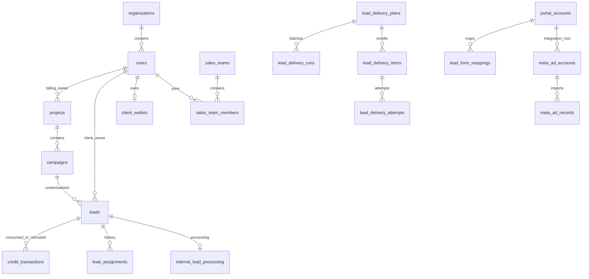

# Database schema and relationships

## Scope and configuration

This is a migration/model-source analysis, not a live database dump. config/database.php defaults SQLite and configures MySQL/MariaDB/PostgreSQL/SQL Server alternatives. Deployment selects DB_CONNECTION and connection variables; its actual engine/schema/data were not read. PHPUnit explicitly uses in-memory SQLite. Validate important FK/type/locking behavior on the production engine before deployment.

## Current identity model

- organizations → users through organization_id. There is no active separate clients table after the October29 consolidation migration.
- Client extends User and sets table=users. projects.client_id, leads.client_id, client_wallets.client_id and ledger/request client_id refer to billing user IDs, not organization IDs.
- projects → campaigns → leads. November2 removes physical leads.project_id. Lead::project is a hasOneThrough relation; compatibility getProjectIdAttribute derives it and setter may create General Campaign.
- users → sales_team_members → sales_teams. Team ownable_type/id is polymorphic; leader_id links user. Older code accepts User ownership as well as Organization.
- leads → assignments, activities/metadata, internal processing, replacements, delivery items and ledger entries. Activity tables usually cascade on lead deletion; retention-relevant delivery references restrict deletion.

Polymorphic team ownership, audit subjects, notifiable entities and multiple Page associations are simplified in diagram; do not infer extra FKs from it.

## High-care columns and constraints

| Area | Current fields/rules |
|---|---|
| Organization | status, auto_assign_enabled, distribution_method, assignment_config JSON, internal_processing_enabled/team/config, delivery timezone, executive_response_minutes, min_credit_threshold, credit visibility setting |
| Lead | unique lead_code; client_id; nullable campaign_id; required lead_source_id; assigned_to; status/current_stage; delivery_pending/at/delivered_at/config/failed_at/error/plan; internal_processing_pending; executive assignment/due/response timestamps; archived_at/by/reason/assignment_hold; credit_delivery_confirmed |
| Wallet | unique client_id; unsigned integer balance/opening_balance; reconciled_at/by; preserved legacy_balance/opening_balance hidden from ordinary serialization |
| Ledger | integer credit_before/used/after; transaction_type/description/created_by; client_id/nullable lead_id/package_id; is_legacy; unique nullable delivery_charge_lead_id; preserved legacy decimal columns |
| Delivery | unique plan organization_id; unique item lead_id; plan/run/item/attempt history with restrictive FKs; run_id can reset for retries; run settings snapshot |
| Internal processing | unique lead_id; status_code FK to internal_processing_statuses.code; verified/requested/forwarded actors/times; separate events |
| Meta | unique ad_account_id; unique account/kind/remote record; unique portal/form mapping; Page pivot composite PK |
| Preferences | general_settings unique user_id/key; theme/table/notification/global-default keys share this storage |
| Audit | append-only model/builder; actor/org/request context and from/to payloads; physical raw SQL is not prevented by Eloquent guards |

Integer credit cost priority: project > supplied team > organization > global default 1. Remaining=wallet.balance; Used=max(0,active nonlegacy lead consumption/reserve/deduct minus lead refunds); Total=Remaining+Used. Legacy values are not spendable without reconciliation. No automatic currency exchange/division. SLA deadline=assigned_at+saved response minutes(default 15); legacy first_response_at and current executive SLA coexist.

## Table inventory

Key columns listed here are intentionally selective, not an executable schema. Source links below map every literal migration table declaration. Spatie table names are configurable.

| Table(s) | Purpose and important references |
|---|---|
| organizations | Tenant groups and delivery/assignment/internal-processing/credit/SLA settings |
| users | Login identity, organization_id, status, roles through pivots; also billing clients |
| roles, permissions | Spatie access names/guard |
| model_has_roles, model_has_permissions, role_has_permissions | Spatie polymorphic user grants and role permissions |
| password_reset_tokens, sessions | Reset email/token and session user_id/payload/activity |
| projects | client_id→users, active/property fields, integer lead_cost override, delivery defaults |
| project_units | project_id, unit number/type, property price/status (money retained for Super Admin) |
| lead_sources | Attribution source, active flag and score weight |
| campaigns | project_id/source_id, name/UTM/status/times/budget; optional delivery overrides |
| campaign_sources | campaign_id, platform/ad set/ad/form attribution |
| channel_partners | Historical/current partner identity linked to organization/project; review callers before removal |
| sales_teams | ownable morph identity, name, leader_id and credit/distribution metadata |
| sales_team_members | team_id/user_id, role/is_active, availability/capacity/priority extensions |
| distribution_rules | project_id, rule_type/config/is_active; older assignment path |
| leads | Master prospect, ownership/campaign/source, stage, assignee, delivery/archive/SLA flags |
| lead_metadata | lead_id/key/value; raw attribution/form answers/Meta leadgen ID |
| lead_assignments | lead_id, assigned_to/by, assigned/unassigned time, response due/first time |
| lead_status_history | lead_id, from/to status, changed_by/at |
| lead_communications | lead_id, client_id→users, user_id, channel/template/message/status/time |
| lead_calls | lead_id/user_id, duration_seconds, outcome, recording URL/called_at |
| lead_messages | lead_id, direction/body/sent_at |
| lead_emails | lead_id, subject/body, sent/opened_at; activity table, not notification queue |
| followups | lead_id, due_at/note/status/created_by |
| meetings | lead_id, scheduled_at/location/participants/type/outcome |
| site_visits | lead_id/unit/executive_id, visit_date/attendance/outcome/remarks |
| proposals | lead_id/unit_id, price/discount/terms/validity/sent/view/status |
| negotiations | lead_id/proposal_id, notes/status |
| bookings | lead_id/unit_id, booking_amount/booked_at/status |
| payments | booking_id, amount/method/transaction/paid_at/status; PaymentReceived aliases this |
| invoices | client_id, invoice_number/amount/due/status; legacy financial subsystem |
| payments_received | invoice_id/amount/method/received_at historical table; PaymentReceived model does NOT use it |
| replacement_reasons | label, eligible/requires_sla_check |
| lead_replacements | lead_id/reason/requester/time/status/SLA/resolution/replacement_lead_id |
| credit_packages | integer credit_count/validity/name; old monetary price renamed legacy_price |
| client_wallets | client_id→users unique, reconciled integer allocation/current credits |
| credit_transactions | Immutable-by-workflow ledger history, lead/package/actor and integer or legacy fields |
| recharge_requests | client/package, compatibility amount now requested integer credits, approved_quantity/status/times/notes |
| credit_disputes | original ledger FK restrict, opened_by/reason/status, resolver/time/resolution, optional adjustment ledger FK restrict |
| notifications | Laravel UUID/notifiable/data/read state plus org/event-key extensions; SystemNotification alias |
| notification_templates | unique key, channel/subject/body |
| notification_logs | notifiable/channel/status/payload/retries/error/email references; channel attempt history |
| browser_push_subscriptions | user_id/org, unique endpoint_hash, stored subscription |
| browser_push_deliveries | user/notification/subscription, attempts/status/error; unique notification/subscription |
| internal_processing_statuses | code PK, labels/order/system/terminal/can_forward flags |
| internal_lead_processing | one row/lead, organization/team/agent, call/verification/handover/forwarding state |
| internal_lead_processing_events | processing_record FK, user/action/details/created_at |
| lead_delivery_plans | source org unique, destination client/project/optional campaign, creator/settings/state/next_run |
| lead_delivery_runs | plan FK, status/settings snapshot/total/start/finish |
| lead_delivery_items | unique lead, source/destination mapping, plan/run/requester/status/attempts/sent/accepted/failure |
| lead_delivery_attempts | item/run FKs, status/failure/time; retains retry history |
| upload_batches | uploader/project/campaign/source, filename/counts/error_log |
| scheduled_task_runs | task/expression/timezone/origin/status/requester/start/end/duration/output/exit/error |
| seeder_runs | seeder class/actor/status/change count/start/end/reverted metadata |
| seeder_run_changes | seeder_run_id, table/operation/record key, before/after values |
| audit_logs | actor/organization, action/subject, before/after/request/context; append-only API |
| api_logs | endpoint/method/payload/response/time; migration existence does not prove comprehensive request logging |
| webhook_logs | portal FK, payload/received/processed/error; intake retry evidence |
| cache, cache_locks | Laravel database cache/atomic lock storage |
| jobs, job_batches, failed_jobs | Laravel queue reservations/batch state/failure payloads |
| migrations | Laravel framework-created applied migration repository |
| clients, client_users | Historical tables explicitly dropped in October29 migration; do not recreate for new functionality |

## Schema evolution and migration dependencies

1. August14 baseline creates organizations, users, original clients/pivot, leads with project_id and decimal wallet fields, activities, messaging, financial records and logs.
2. August16 adds general_settings, forms/mappings and indexes. Spatie creates configurable permission tables.
3. October20 removes organization type and consolidates roles. October24 extends pricing/distribution/notification fields.
4. October29 migrates clients into users, rebinds client FKs, drops clients/client_users. Migration updates data and catches some constraint errors; fresh SQLite success alone does not prove production legacy migration integrity.
5. November2 migrates lead project context through campaigns and drops leads.project_id. Never infer final schema from initial create migration.
6. November11–18 add ledger descriptions/types, delivery configuration, notification/audit context, internal processing/team leaders, tracked seeders, push, delivery batches, assignment JSON, optional plan campaign, monitoring and visibility.
7. November19 adds archive metadata and assignment response SLA.
8. November20 adds form creation metadata; November21 adds independent Meta Ad Accounts, then integer-credit schema and disputes.

Credit migration renames exact historical decimals to legacy_*; creates integer active values; marks old transactions is_legacy; starts existing accounts zero/unreconciled; preserves whole-number positive pricing overrides; snapshots package credit_count for old requests. down() deliberately throws: reviewed backup restore required. Refer to docs/lead-credits-migration.md.

## Seeders, aliases and suspected legacy use

DatabaseSeeder wraps RoleSeeder → organizations/users/access repair → client/projects/source/campaign/partner/rules → packages/leads/credit ledger → communications/activities/replacements/audits in a transaction. Demo/Deltek/org-specific repair seeders are separate. Tracked seeder infrastructure records reversibility metadata but does not make every arbitrary data migration safe.

RoleAndPermissionSeeder delegates RoleSeeder; several role seeders/repair migrations overlap. Payment and PaymentReceived target payments; invoices/payments_received coexist historically. Empty model/listener files and low caller counts are not proof of unused tables. No table is recommended for deletion without reference/data/retention review. Query-builder raw SQL and FKs must be checked when archiving/purging; Eloquent archive filtering is not a database row-level security policy.

## Migration provenance index

The following lists tables mentioned by literal Schema::create/table declarations in each migration up() body. It is a source index, not a final schema diff; dynamic loops/Spatie-config names and raw SQL may add operations. Open a listed file before changing its table. Do not execute migrations to explore production.

- [0001_01_01_000001_create_cache_table.php](../database/migrations/0001_01_01_000001_create_cache_table.php): `cache`, `cache_locks`.
- [0001_01_01_000002_create_jobs_table.php](../database/migrations/0001_01_01_000002_create_jobs_table.php): `jobs`, `job_batches`, `failed_jobs`.
- [2026_08_14_000001_create_organizations_table.php](../database/migrations/2026_08_14_000001_create_organizations_table.php): `organizations`.
- [2026_08_14_000002_create_users_table.php](../database/migrations/2026_08_14_000002_create_users_table.php): `users`, `password_reset_tokens`, `sessions`.
- [2026_08_14_000003_create_permission_tables.php](../database/migrations/2026_08_14_000003_create_permission_tables.php): Dynamic/data/access operations; inspect source.
- [2026_08_14_000004_create_clients_table.php](../database/migrations/2026_08_14_000004_create_clients_table.php): `clients`.
- [2026_08_14_000005_create_client_users_table.php](../database/migrations/2026_08_14_000005_create_client_users_table.php): `client_users`.
- [2026_08_14_000006_create_portal_accounts_table.php](../database/migrations/2026_08_14_000006_create_portal_accounts_table.php): `portal_accounts`.
- [2026_08_14_000007_create_integration_credentials_table.php](../database/migrations/2026_08_14_000007_create_integration_credentials_table.php): `integration_credentials`.
- [2026_08_14_000008_create_projects_table.php](../database/migrations/2026_08_14_000008_create_projects_table.php): `projects`.
- [2026_08_14_000009_create_project_units_table.php](../database/migrations/2026_08_14_000009_create_project_units_table.php): `project_units`.
- [2026_08_14_000010_create_lead_sources_table.php](../database/migrations/2026_08_14_000010_create_lead_sources_table.php): `lead_sources`.
- [2026_08_14_000011_create_campaigns_table.php](../database/migrations/2026_08_14_000011_create_campaigns_table.php): `campaigns`.
- [2026_08_14_000012_create_campaign_sources_table.php](../database/migrations/2026_08_14_000012_create_campaign_sources_table.php): `campaign_sources`.
- [2026_08_14_000013_create_channel_partners_table.php](../database/migrations/2026_08_14_000013_create_channel_partners_table.php): `channel_partners`.
- [2026_08_14_000014_create_sales_teams_table.php](../database/migrations/2026_08_14_000014_create_sales_teams_table.php): `sales_teams`.
- [2026_08_14_000015_create_sales_team_members_table.php](../database/migrations/2026_08_14_000015_create_sales_team_members_table.php): `sales_team_members`.
- [2026_08_14_000016_create_distribution_rules_table.php](../database/migrations/2026_08_14_000016_create_distribution_rules_table.php): `distribution_rules`.
- [2026_08_14_000017_create_leads_table.php](../database/migrations/2026_08_14_000017_create_leads_table.php): `leads`.
- [2026_08_14_000018_create_lead_metadata_table.php](../database/migrations/2026_08_14_000018_create_lead_metadata_table.php): `lead_metadata`.
- [2026_08_14_000019_create_lead_assignments_table.php](../database/migrations/2026_08_14_000019_create_lead_assignments_table.php): `lead_assignments`.
- [2026_08_14_000020_create_lead_status_history_table.php](../database/migrations/2026_08_14_000020_create_lead_status_history_table.php): `lead_status_history`.
- [2026_08_14_000021_create_lead_communications_table.php](../database/migrations/2026_08_14_000021_create_lead_communications_table.php): `lead_communications`.
- [2026_08_14_000022_create_lead_calls_table.php](../database/migrations/2026_08_14_000022_create_lead_calls_table.php): `lead_calls`.
- [2026_08_14_000023_create_lead_messages_table.php](../database/migrations/2026_08_14_000023_create_lead_messages_table.php): `lead_messages`.
- [2026_08_14_000024_create_lead_emails_table.php](../database/migrations/2026_08_14_000024_create_lead_emails_table.php): `lead_emails`.
- [2026_08_14_000025_create_notifications_table.php](../database/migrations/2026_08_14_000025_create_notifications_table.php): `notifications`.
- [2026_08_14_000026_create_notification_logs_table.php](../database/migrations/2026_08_14_000026_create_notification_logs_table.php): `notification_logs`.
- [2026_08_14_000027_create_followups_table.php](../database/migrations/2026_08_14_000027_create_followups_table.php): `followups`.
- [2026_08_14_000028_create_meetings_table.php](../database/migrations/2026_08_14_000028_create_meetings_table.php): `meetings`.
- [2026_08_14_000028_create_notification_templates_table.php](../database/migrations/2026_08_14_000028_create_notification_templates_table.php): `notification_templates`.
- [2026_08_14_000029_create_site_visits_table.php](../database/migrations/2026_08_14_000029_create_site_visits_table.php): `site_visits`.
- [2026_08_14_000030_create_proposals_table.php](../database/migrations/2026_08_14_000030_create_proposals_table.php): `proposals`.
- [2026_08_14_000031_create_negotiations_table.php](../database/migrations/2026_08_14_000031_create_negotiations_table.php): `negotiations`.
- [2026_08_14_000032_create_bookings_table.php](../database/migrations/2026_08_14_000032_create_bookings_table.php): `bookings`.
- [2026_08_14_000033_create_payments_table.php](../database/migrations/2026_08_14_000033_create_payments_table.php): `payments`.
- [2026_08_14_000034_create_replacement_reasons_table.php](../database/migrations/2026_08_14_000034_create_replacement_reasons_table.php): `replacement_reasons`.
- [2026_08_14_000035_create_lead_replacements_table.php](../database/migrations/2026_08_14_000035_create_lead_replacements_table.php): `lead_replacements`.
- [2026_08_14_000036_create_credit_packages_table.php](../database/migrations/2026_08_14_000036_create_credit_packages_table.php): `credit_packages`.
- [2026_08_14_000037_create_client_wallets_table.php](../database/migrations/2026_08_14_000037_create_client_wallets_table.php): `client_wallets`.
- [2026_08_14_000038_create_credit_transactions_table.php](../database/migrations/2026_08_14_000038_create_credit_transactions_table.php): `credit_transactions`.
- [2026_08_14_000039_create_recharge_requests_table.php](../database/migrations/2026_08_14_000039_create_recharge_requests_table.php): `recharge_requests`.
- [2026_08_14_000040_create_invoices_table.php](../database/migrations/2026_08_14_000040_create_invoices_table.php): `invoices`.
- [2026_08_14_000041_create_payments_received_table.php](../database/migrations/2026_08_14_000041_create_payments_received_table.php): `payments_received`.
- [2026_08_14_000042_create_audit_logs_table.php](../database/migrations/2026_08_14_000042_create_audit_logs_table.php): `audit_logs`.
- [2026_08_14_000043_create_api_logs_table.php](../database/migrations/2026_08_14_000043_create_api_logs_table.php): `api_logs`.
- [2026_08_14_000044_create_webhook_logs_table.php](../database/migrations/2026_08_14_000044_create_webhook_logs_table.php): `webhook_logs`.
- [2026_08_14_000045_add_notes_to_recharge_requests_table.php](../database/migrations/2026_08_14_000045_add_notes_to_recharge_requests_table.php): `recharge_requests`.
- [2026_08_14_000046_add_default_score_weight_to_lead_sources_table.php](../database/migrations/2026_08_14_000046_add_default_score_weight_to_lead_sources_table.php): `lead_sources`.
- [2026_08_14_000047_create_upload_batches_table.php](../database/migrations/2026_08_14_000047_create_upload_batches_table.php): `upload_batches`.
- [2026_08_16_000001_add_indexes_for_searchable_select.php](../database/migrations/2026_08_16_000001_add_indexes_for_searchable_select.php): `projects`, `users`, `clients`.
- [2026_08_16_000030_create_general_settings_table.php](../database/migrations/2026_08_16_000030_create_general_settings_table.php): `general_settings`.
- [2026_08_16_000040_create_lead_form_mappings_table.php](../database/migrations/2026_08_16_000040_create_lead_form_mappings_table.php): `portal_accounts`, `lead_form_mappings`.
- [2026_08_18_000050_allow_git_in_portal_accounts_type.php](../database/migrations/2026_08_18_000050_allow_git_in_portal_accounts_type.php): `portal_accounts`.
- [2026_10_20_000001_drop_type_from_organizations_table.php](../database/migrations/2026_10_20_000001_drop_type_from_organizations_table.php): `organizations`.
- [2026_10_20_000002_consolidate_roles_and_remove_duplicates.php](../database/migrations/2026_10_20_000002_consolidate_roles_and_remove_duplicates.php): Dynamic/data/access operations; inspect source.
- [2026_10_24_000001_add_lead_pricing_distribution_and_notification_enhancements.php](../database/migrations/2026_10_24_000001_add_lead_pricing_distribution_and_notification_enhancements.php): `organizations`, `sales_teams`, `projects`, `leads`, `client_wallets`, `sales_team_members`, `notification_logs`.
- [2026_10_29_000001_remove_clients_table_and_rebind_to_users.php](../database/migrations/2026_10_29_000001_remove_clients_table_and_rebind_to_users.php): `client_users`, `projects`, `leads`, `client_wallets`, `credit_transactions`, `invoices`, `lead_communications`, `recharge_requests`.
- [2026_10_30_000001_remove_account_manager_role.php](../database/migrations/2026_10_30_000001_remove_account_manager_role.php): Dynamic/data/access operations; inspect source.
- [2026_11_01_000002_add_client_id_to_lead_form_mappings.php](../database/migrations/2026_11_01_000002_add_client_id_to_lead_form_mappings.php): `lead_form_mappings`.
- [2026_11_01_000003_sync_meta_form_and_campaign_exact_names.php](../database/migrations/2026_11_01_000003_sync_meta_form_and_campaign_exact_names.php): Dynamic/data/access operations; inspect source.
- [2026_11_02_000004_remove_project_id_from_leads_table.php](../database/migrations/2026_11_02_000004_remove_project_id_from_leads_table.php): `leads`, `campaigns`.
- [2026_11_11_000001_add_credit_ledger_and_distribution_enhancements.php](../database/migrations/2026_11_11_000001_add_credit_ledger_and_distribution_enhancements.php): `credit_transactions`, `organizations`.
- [2026_11_11_000002_seed_standard_replacement_reasons.php](../database/migrations/2026_11_11_000002_seed_standard_replacement_reasons.php): Dynamic/data/access operations; inspect source.
- [2026_11_12_180000_add_lead_delivery_settings.php](../database/migrations/2026_11_12_180000_add_lead_delivery_settings.php): `leads`.
- [2026_11_13_000001_correct_delivery_configuration.php](../database/migrations/2026_11_13_000001_correct_delivery_configuration.php): `organizations`, `projects`, `leads`.
- [2026_11_13_100000_extend_web_notifications.php](../database/migrations/2026_11_13_100000_extend_web_notifications.php): `notifications`, `users`.
- [2026_11_14_000001_enrich_audit_log_context.php](../database/migrations/2026_11_14_000001_enrich_audit_log_context.php): `audit_logs`.
- [2026_11_15_000001_add_internal_lead_processing.php](../database/migrations/2026_11_15_000001_add_internal_lead_processing.php): `internal_processing_statuses`, `organizations`, `leads`, `internal_lead_processing`, `internal_lead_processing_events`.
- [2026_11_15_000002_add_team_leader_support.php](../database/migrations/2026_11_15_000002_add_team_leader_support.php): `sales_teams`.
- [2026_11_16_000001_create_seeder_run_tracking.php](../database/migrations/2026_11_16_000001_create_seeder_run_tracking.php): `seeder_runs`, `seeder_run_changes`.
- [2026_11_16_000002_add_email_notification_reference.php](../database/migrations/2026_11_16_000002_add_email_notification_reference.php): `notification_logs`.
- [2026_11_16_000003_create_browser_push_tables.php](../database/migrations/2026_11_16_000003_create_browser_push_tables.php): `browser_push_subscriptions`, `browser_push_deliveries`.
- [2026_11_17_180000_add_client_delivery_batches.php](../database/migrations/2026_11_17_180000_add_client_delivery_batches.php): `lead_delivery_plans`, `lead_delivery_runs`, `lead_delivery_items`, `lead_delivery_attempts`, `leads`.
- [2026_11_17_190000_add_organization_assignment_config.php](../database/migrations/2026_11_17_190000_add_organization_assignment_config.php): `organizations`.
- [2026_11_18_000001_make_delivery_plan_campaign_optional.php](../database/migrations/2026_11_18_000001_make_delivery_plan_campaign_optional.php): `lead_delivery_plans`.
- [2026_11_18_000002_create_scheduled_task_runs.php](../database/migrations/2026_11_18_000002_create_scheduled_task_runs.php): `scheduled_task_runs`.
- [2026_11_18_000004_add_builder_credit_balance_visibility.php](../database/migrations/2026_11_18_000004_add_builder_credit_balance_visibility.php): `organizations`.
- [2026_11_18_000005_repair_team_leader_permissions.php](../database/migrations/2026_11_18_000005_repair_team_leader_permissions.php): Dynamic/data/access operations; inspect source.
- [2026_11_19_100000_add_lead_archiving.php](../database/migrations/2026_11_19_100000_add_lead_archiving.php): `leads`.
- [2026_11_19_180000_add_executive_response_sla.php](../database/migrations/2026_11_19_180000_add_executive_response_sla.php): `organizations`, `leads`, `lead_assignments`.
- [2026_11_20_120000_add_meta_created_at_to_lead_form_mappings.php](../database/migrations/2026_11_20_120000_add_meta_created_at_to_lead_form_mappings.php): `lead_form_mappings`.
- [2026_11_21_000001_create_meta_ad_accounts.php](../database/migrations/2026_11_21_000001_create_meta_ad_accounts.php): `meta_ad_accounts`, `meta_ad_account_pages`, `meta_ad_records`.
- [2026_11_21_100000_introduce_integer_lead_credits.php](../database/migrations/2026_11_21_100000_introduce_integer_lead_credits.php): `client_wallets`, `credit_transactions`, `leads`, `organizations`, `recharge_requests`, `credit_packages`, `credit_disputes`.
