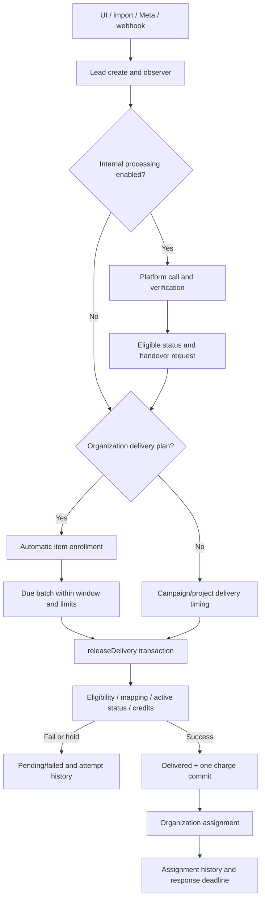

# Lead distribution, client delivery and executive assignment

## Separate concepts

Internal processing = platform calling/verification. Client delivery = releasing/transfer into the client panel with successful credit consumption. Executive assignment = choosing the client team member. Each has separate settings; executive response SLA is a fourth independent clock.

## Intake and hooks

Webhook controllers log requests and dispatch ProcessInboundLeadJob; Meta batches split into child jobs. MetaLeadSyncService also polls forms/leads. BulkLeadUpload maps/validates CSV/Excel rows and records UploadBatch. UI/replacement creation also uses Lead hooks.

LeadObserver::creating calls scheduleDelivery. created captures plan items or starts internal processing. LeadCreated is handled by ReserveCreditOnLeadCreated, which now calls release/internal paths despite its old name. Creation/queue enrollment alone must not consume credits. Avoid repeating hook writes in another controller.

## Scheduling precedence

`LeadDistributionService::scheduleDelivery`:

1. Internal enabled: hold internal_processing_pending and delivery_pending, clear assignee/date.
2. New intake/internal handover with an organization plan: attach plan and hold for its cycle.
3. Otherwise campaign interval/daily limit override project defaults; timezone derives from recipient organization or app.
4. Last delivered/scheduled time and daily reserved planning slots determine next delivery_at. Pending slots are not successful delivery counts.
5. Campaign-less handover can become immediately pending; the creation-event release path also handles campaign-less intake.

## Automatic delivery plan

Source: `app/Services/Concerns/ProcessesClientDelivery.php`.

One plan per source organization; destination is a client user/project and optional campaign. Settings JSON includes frequency, automatic, fixed/all quantity, max cycle, daily cap toggle/limit, timezone, dates, working days/window and daily/weekly slots. Items retain source client/campaign and destination mapping.

`clientDeliveryCandidates` selects source-organization owners, undelivered/nonterminal leads, compatible plan association and no active nonlegacy lead ledger record. `applyClientDeliveryApproval` requires verified internal processing, verified timestamp, forwarding status and handover requester/time **only when internal_processing_enabled is true**. Disabled processing skips that internal approval gate. There is no independent universal consent check in this helper; old labels mentioning consent are not proof of a separate field.

`startClientDeliveryCycle` locks plan; enrolls automatically when enabled or a manual cycle is requested; enforces window/due time; recovers queued/running/paused run; caps selected pending items; snapshots settings to a run. Failed unsent items retry after `min(3600,60*2^min(6,attempts-1))` seconds in automatic cycles, preserving history.

`processClientDeliveryRun` locks plan/run/item/client/project/lead. It checks destination active status, project/campaign association, current approval/eligibility and matching already-delivered mobile/email. It changes recipient/campaign then calls releaseDelivery. Each result records item status, attempt count, sent_at/failure and an attempt-history row. A completed task/run is not proof every item succeeded.

Optional Send Cycle Now remains; manual cycle requests still obey saved window/capacity. Old enqueue helper is compatibility code; automatic operation requires no Queue Eligible click.

## Atomic delivery and credits

releaseDelivery rechecks plan-run authorization, due/pending state, internal approval, campaign/project active/delivery settings and timing limits. Delivered visibility and `credit_delivery_confirmed` are set in the same outer transaction as CreditTransaction::reserveForLead and assignment. Failure restores hold state or rolls downstream changes back and records/reports errors.

reserveForLead requires delivered_at, not pending, service confirmation, valid status, active client/org and reconciled sufficient credits. It locks lead/wallet, checks existing active charges and writes integer consumption. Unique delivery_charge_lead_id protects against duplicate lead charges. The old “reserve” name is retained for compatibility; it is successful-delivery consumption now.

Never charge intake, pending/failed/duplicate delivery, or assignment retries. Never use a raw delivered_at update as a substitute for releaseDelivery.

## Assignment branches

`distribute` respects archive/restoration assignment hold. If organization.assignment_config is non-null, use ConfiguresTeamAssignment; otherwise use legacy project DistributionRule and organization defaults. The branches are not behaviorally identical.

Configured defaults: enabled flag, round robin, per-executive daily assignment limit 0/unlimited, batch size1, full-day window, timezone, team, project/campaign eligibility and member availability/priority. Active same-org users with active team membership are eligible. Methods: round robin, priority, equal_distribution; old service also supports location/team/capacity/manual. No cross-organization fallback; retain unassigned if no candidate.

processOrganizationAssignments handles at most configured batch_size pending delivered/unassigned leads per invocation. distributeConfiguredLead serializes org selection/quota under an organization lock. assignLeadToUser locks lead, closes prior active assignment, changes assignee/stage and adds LeadAssignment. Transient webAssignmentRecorded suppresses duplicate observer history. Repeating the same active assignment is a no-op.

LeadAssignment creation calls ExecutiveResponseService; due time = assignment time + saved response minutes. Reassignment creates a new current SLA and clears current executive first response while retaining history.

## Troubleshooting order

Archive/assignment hold → source/destination identity/status → internal switch/verification/handover → plan state/automatic/window/next_run_at → item/run duplicate and failure history → wallet reconciliation/credits → project/campaign validity → assignment team/membership/availability/quota → scheduler and worker records. Running cron repeatedly cannot fix missing approval, mappings or credits.
