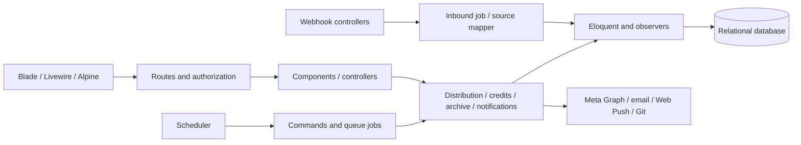

# Lead Panther: project overview

> Reviewed 21 November 2026 (Asia/Calcutta), HEAD `52bc995` plus existing working-tree changes. Local source describes intended behavior; production schema, credentials and deployment were not inspected. Application code, configuration and database were left unchanged.

## Reading order

Start with [AI_AGENT_CONTEXT.md](AI_AGENT_CONTEXT.md). Detailed references:

| Document | Purpose |
|---|---|
| [PROJECT_STRUCTURE.md](PROJECT_STRUCTURE.md) | Source map and route entry points |
| [DATABASE_SCHEMA.md](DATABASE_SCHEMA.md) | Relationships, tables, migration history |
| [USER_ROLES_PERMISSIONS.md](USER_ROLES_PERMISSIONS.md) | Roles and actual enforcement layers |
| [BUSINESS_WORKFLOWS.md](BUSINESS_WORKFLOWS.md) | Operational behavior and implementation |
| [LEAD_DISTRIBUTION_FLOW.md](LEAD_DISTRIBUTION_FLOW.md) | Intake, approval, delivery, credit consumption, assignment |
| [CRON_QUEUE_SYSTEM.md](CRON_QUEUE_SYSTEM.md) | Tasks, jobs, recovery and monitoring |
| [API_INTEGRATIONS.md](API_INTEGRATIONS.md) | APIs, Meta, notifications and Git |
| [FRONTEND_COMPONENTS.md](FRONTEND_COMPONENTS.md) | Layouts, theme and reusable UI |
| [KNOWN_ISSUES.md](KNOWN_ISSUES.md) | Confirmed findings versus runtime questions |
| [DEVELOPMENT_GUIDELINES.md](DEVELOPMENT_GUIDELINES.md) | Safe implementation and test guidance |

## Architecture

Lead Panther is a Laravel monolith for a multi-organization real-estate CRM. It uses server-rendered Blade and Livewire rather than a separate SPA. HTTP routes mount Livewire pages or dashboard controllers. Component actions call shared services/Eloquent models. Observers and typed event listeners add scheduling, assignment history, executive response deadlines, notifications and audits. Laravel schedules commands/jobs and a bounded queue worker.

The tenant grouping is `Organization`. A billing client is a `users` row, read through `User` or compatibility subclass `Client`. A lead belongs to a client user and campaign; project is derived from campaign. Organization IDs and client/user IDs are different domains.

## Stack

Versions verified from `composer.lock`:

| Dependency | Locked version |
|---|---|
| Laravel | 12.66.0 |
| Livewire | 3.8.4 |
| Volt | 1.11.2 |
| Spatie Laravel Permission | 6.25.0 |
| Maatwebsite Excel | 3.1.70 |
| Laravel Reverb | 1.13.0 |

Composer requires PHP `^8.2`, Breeze `^2.4`, Web Push `~11.0`, Backup `^9.3`, PHPUnit `^11.5.50`. The JS manifest declares Vite `^7.0.7`, Tailwind `^3.1.0`, Alpine-style directives, Axios, Flatpickr, Laravel Echo and Pusher JS. It also declares the Tailwind v4 Vite plugin, but `vite.config.js` uses the Laravel Vite plugin only. Allowed dependency ranges are not installed/deployed version guarantees; preserve lockfiles.

## Modules

Organizations/clients, projects/campaigns, Meta form mapping, lead capture/import, internal calling/verification, timed client delivery, executive assignment/teams, lead stages and follow-ups, lead credits/reconciliation/disputes, replacements, reports/Excel, archive/restore, notification inbox/browser push/email, audits, backups, tracked seeders and Git operations.

WhatsApp/SMS sending is simulated in the reviewed source. No Gemini implementation was found in `app/` or `config/`. User requests or old UI labels are not proof of implemented functionality.

## Evidence and limits

Reviewed routes, manifests, migration source, core model relationships/scoping, shared services, intake jobs, permissions, representative Livewire actions, notification/operational infrastructure and reusable UI. The table inventory is migration-derived, not a live database inspection. No migrations, seeders, business commands, tests, external API calls or live jobs were run for this documentation task. Prior test results are labeled historical in KNOWN_ISSUES. This is a prioritized architectural review, not a claim that every minor field or vendor function was audited.
